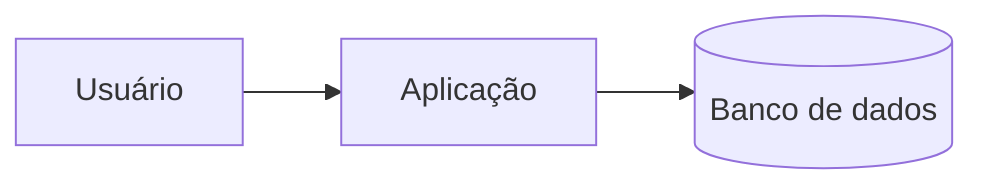

# Arquitetura

Visão geral em poucas frases: o que o sistema faz e seus limites.

## Componentes

- Aplicação: responsabilidade principal.
- Banco de dados: o que guarda.

## Decisões

Veja `docs/adr/`.
